  

### Selected work

<!-- Contact section -->

<!-- Original profile views badge -->

  

<!-- Preserve the existing contribution snake and its output-branch workflow. -->

  <picture>
    <source media="(prefers-color-scheme: dark)" srcset="https://raw.githubusercontent.com/mahmoudfalous/mahmoudfalous/output/github-snake-dark.svg" />
    <source media="(prefers-color-scheme: light)" srcset="https://raw.githubusercontent.com/mahmoudfalous/mahmoudfalous/output/github-snake.svg" />
    
  </picture>

